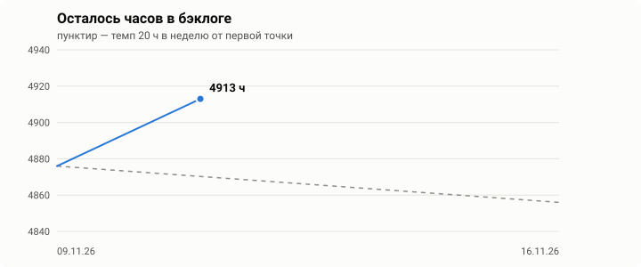

# PSN бэклог · Anton_games337

Уровень **558** · 🏆 215 · 🥇 1141 · 🥈 3212 · 🥉 8447  
Списков трофеев: **369**, закрыто на 100%: **233**, в бэклоге: **136**  
Данные PSN: 2026-11-09

## Итого осталось

| | Трофеев | Время (оценка) |
|---|---:|---:|
| Можно выбить офлайн | 4715 | ~4602 ч |
| [🌐 Невыбитый онлайн (сервера живы)](ONLINE.md) | 146 | ~274 ч |
| **Всего выбиваемо** | **4861** | **~4876 ч** |
| [⛔ Недоступно сейчас (DLC: The Division 2, Astro's Playroom)](UNOBTAINABLE.md#недоступно-сейчас) | 23 | ~21 ч |
| [💀 Сервера закрыты](UNOBTAINABLE.md#сервера-закрыты) | 0 | — |
| [🐞 Глючные](UNOBTAINABLE.md#глючные-трофеи) | 0 | — |
| Всего невыбитых | 4884 | |

## 📉 Динамика

При 20 ч в неделю текущий остаток — это **~244 недель** (≈ 4.7 года).

Таблица по датам

| Дата | Выбиваемых трофеев | Осталось ч | Офлайн ч | Онлайн ч | Платин |
|---|---:|---:|---:|---:|---:|
| 2026-11-09 | 4861 | 4876 | 4602 | 274 | 215 |

Вся история — в [`data/history.csv`](data/history.csv).

## 🏆 Недавно закрыто на 100%

- Evil Dead: The Game · PS5 — 2026-11-09 · платина
- Minecraft: PlayStation4 Edition (2) · PS4 — 2026-10-29
- Minecraft: PlayStation5 Edition · PS5 — 2026-10-29 · платина
- Kingdom Come: Deliverance · PS5 — 2026-10-11 · платина
- Kingdom Come: Deliverance · PS4 — 2026-10-11 · платина

## ⚡ Быстрые победы (≤ 3 ч)

- [L.A. Noire](games/l-a-noire-ps3.md) · PS3 — ~0.3 ч, осталось 2 трофея
- [Zombie Army 4: Dead War](games/zombie-army-4-dead-war-ps4.md) · PS4 — ~0.3 ч, осталось 2 трофея
- [Resident Evil 4](games/resident-evil-4-ps5.md) · PS5 — ~0.5 ч, осталось 7 трофеев 🔁 при переносе сейва/автопопе, иначе до 12 ч
- [Call of Duty: Black Ops II](games/call-of-duty-black-ops-ii-ps4.md) · PS4 — ~2 ч, осталось 37 трофеев 🔁 при переносе сейва/автопопе, иначе до 26 ч
- [Back to the Future - Episode 1: It's About Time](games/back-to-the-future-episode-1-its-about-time-ps3.md) · PS3 — ~2 ч, осталось 8 трофеев
- [Paranormal Activity](games/paranormal-activity-ps4.md) · PS4 — ~3 ч, осталось 11 трофеев

💲 Платные DLC в остатке: проверьте, что они куплены (27 игр, 501 трофей, ~383 ч)

| Игра | Платформа | Трофеев | ~ч | DLC |
|---|---|---:|---:|---|
| [HITMAN 2](games/hitman-2-ps4.md) | PS4 | 58 | 42 | HITMAN 2 Expansion Pass, HITMAN 2 Legacy Pack |
| [Fallout 4](games/fallout-4-ps4.md) | PS4 | 34 | 41 | Automatron, Contraptions Workshop, Far Harbor, Nuka-World, Vault-Tec Workshop, Wasteland Workshop |
| [Resident Evil 7: Biohazard](games/resident-evil-7-biohazard-ps4.md) | PS4 | 19 | 26 | Banned Footage Vol. 1, Banned Footage Vol. 2, End of Zoe |
| [The Evil Within](games/the-evil-within-ps4.md) | PS4 | 30 | 23 | The Assignment, The Consequence, The Executioner |
| [BATMAN: ARKHAM KNIGHT](games/batman-arkham-knight-ps4.md) | PS4 | 36 | 22 | Season Pass / Premium Edition |
| [DRIVECLUB](games/driveclub-ps4.md) | PS4 | 79 | 21 | Apex pack, Downforce pack, Elements pack, Evolution pack, Horsepower pack, Lamborghini Icons pack, Lamborghini pack, Midnight pack, Pacesetter pack, RPM pack, Redline pack, Sakura pack, Torque pack, Turbocharged pack, Unite In Speed pack, Velocity pack |
| [Far Cry 5](games/far-cry-5-ps4.md) | PS4 | 21 | 19 | Dead Living Zombies, Hours of Darkness, Lost on Mars |
| [Cyberpunk 2077](games/cyberpunk-2077-ps5.md) | PS5 | 13 | 18 | Phantom Liberty |
| [Middle-earth: Shadow of War](games/middle-earth-shadow-of-war-ps4.md) | PS4 | 20 | 17 | The Blade of Galadriel Story Expansion, The Desolation of Mordor Story Expansion |
| [Just Cause 3](games/just-cause-3-ps4.md) | PS4 | 19 | 16 | Bavarium Sea Heist, Mech Land Assault, Sky Fortress |
| [HITMAN 2 Expansion](games/hitman-2-expansion-ps4.md) | PS4 | 20 | 16 | HITMAN 2 Expansion Pass |
| [Dying Light](games/dying-light-ps4.md) | PS4 | 10 | 13 | The Following |
| [Marvel's Spider-Man](games/marvels-spider-man-ps4.md) | PS4 | 21 | 12 | The City That Never Sleeps: Silver Lining, The City That Never Sleeps: The Heist, The City That Never Sleeps: Turf Wars |
| [Resident Evil 4](games/resident-evil-4-ps4.md) | PS4 | 7 | 12 | Separate Ways |
| [Assassin's Creed III](games/assassins-creed-iii-ps3.md) | PS3 | 10 | 11 | The Tyranny of King Washington Ep.1, The Tyranny of King Washington Ep.2, The Tyranny of King Washington Ep.3 |
| [DEAD OR ALIVE Xtreme 3 Fortune](games/dead-or-alive-xtreme-3-fortune-ps4.md) | PS4 | 6 | 10 | Leifang Character License, Misaki Character License |
| [Control](games/control-ps4.md) | PS4 | 21 | 9.6 | AWE, The Foundation |
| [AC Brotherhood](games/ac-brotherhood-ps3.md) | PS3 | 10 | 9.5 | The Da Vinci Disappearance |
| [Assassin's Creed Syndicate](games/assassins-creed-syndicate-ps4.md) | PS4 | 7 | 7.7 | Jack the Ripper |
| [Deus Ex: Mankind Divided](games/deus-ex-mankind-divided-ps4.md) | PS4 | 18 | 7.5 | A Criminal Past, System Rift |
| [Tom Clancy's Ghost Recon Future Soldier](games/tom-clancys-ghost-recon-future-soldier-ps3.md) | PS3 | 5 | 7 | Raven Strike Pack |
| [Far Cry 4](games/far-cry-4-ps3.md) | PS3 | 7 | 6 | Valley of the Yetis |
| [Far Cry 4](games/far-cry-4-ps4.md) | PS4 | 7 | 5.5 | Valley of the Yetis |
| [Outlast](games/outlast-ps4.md) | PS4 | 6 | 5.1 | Outlast: Whistleblower |
| [Arizona Sunshine](games/arizona-sunshine-ps4.md) | PS4 | 6 | 5 | Dead Man DLC |
| [DRIVECLUB BIKES](games/driveclub-bikes-ps4.md) | PS4 | 4 | 2.1 | Suzuki bike pack |
| [Resident Evil 4](games/resident-evil-4-ps5.md) | PS5 | 7 | 0.5 | Separate Ways |

Если DLC нет и купить нельзя, отметьте его группу в `data/overrides.json` → `unobtainable_groups`.

## По платформам

| Платформа | Игр в бэклоге | Выбиваемых трофеев | ~ч |
|---|---:|---:|---:|
| PS4 | 81 | 3215 | 3335 |
| PS3 | 24 | 809 | 796 |
| PS Vita | 17 | 401 | 414 |
| PS5 | 14 | 436 | 330 |

## Все игры бэклога

Отсортировано по оценке оставшегося времени. ⚠ — в остатке есть онлайн, 🔁 — оценка при переносе сейва/автопопе с другой версии, ⛔ — остались только недоступные трофеи.

| # | Игра | Платформа | Прогресс | Платина | Осталось | Офлайн | Онлайн | Недоступно | Наиграно | Сложность |
|---:|---|---|---|:---:|---:|---:|---:|---:|---:|---|
| 1 | [L.A. Noire](games/l-a-noire-ps3.md) | PS3 | 59/61 (99%) | ❌ | **0.3 ч** | 0.3 | 0 |  |  | 3/10 |
| 2 | [Zombie Army 4: Dead War](games/zombie-army-4-dead-war-ps4.md) | PS4 | 69/71 (98%) | ❌ | **0.3 ч** | 0.3 | 0 |  | 30 ч | 3/10 |
| 3 | [Resident Evil 4](games/resident-evil-4-ps5.md) | PS5 | 40/47 (84%) | ✅ | **0.5 ч** 🔁 | 0.5 | 0 |  | 0.6 ч | 4/10 (Separate Ways) |
| 4 | [Call of Duty: Black Ops II](games/call-of-duty-black-ops-ii-ps4.md) | PS4 | 54/91 (58%) | ❌ | **2 ч** 🔁 | 2 | 0 |  | 235 ч | 7-8/10 (full list); campaign part ~5/10 |
| 5 | [Back to the Future - Episode 1: It's About Time](games/back-to-the-future-episode-1-its-about-time-ps3.md) | PS3 | 4/12 (23%) | — | **2 ч** | 2 | 0 |  |  |  |
| 6 | [Paranormal Activity](games/paranormal-activity-ps4.md) | PS4 | 1/12 (9%) | ❌ | **3 ч** | 3 | 0 |  |  | 4.75/10 (Stratege votes) |
| 7 | [Grand Theft Auto V](games/grand-theft-auto-v-ps5.md) | PS5 | 39/78 (50%) | ❌ | **4.4 ч** 🔁 | 4.4 | 0 |  |  | 5/10 |
| 8 | [Call of Duty Modern Warfare II](games/call-of-duty-modern-warfare-ii-ps5-npwr50314_00.md) | PS5 | 12/25 (51%) | ❌ | **4.5 ч** | 4.5 | 0 |  | 15 ч | 5/10 |
| 9 | [Journey](games/journey-ps4.md) ⚠ | PS4 | 2/14 (9%) | — | **6.4 ч** | 3.9 | 2.5 |  | 3.9 ч |  |
| 10 | [Battlefield 3](games/battlefield-3-ps3.md) | PS3 | 43/64 (73%) | ❌ | **9 ч** | 9 | 0 |  |  | 3/10 (remaining campaign part) |
| 11 | [The Order: 1886](games/the-order-1886-ps4.md) | PS4 | 7/22 (37%) | ❌ | **10 ч** | 10 | 0 |  | 11 ч | 2/10 |
| 12 | [Lemmings Touch](games/lemmings-touch-psvita.md) | PSVITA | 13/27 (26%) | ❌ | **10 ч** | 10 | 0 |  |  | 4/10 |
| 13 | [Ratchet & Clank: Full Frontal Assault](games/ratchet-clank-full-frontal-assault-ps3-psvita.md) | PS3,PSVITA | 8/23 (23%) | ❌ | **11 ч** | 11 | 0 |  |  |  |
| 14 | [Tom Clancy's Ghost Recon Future Soldier](games/tom-clancys-ghost-recon-future-soldier-ps3.md) | PS3 | 53/60 (85%) | ❌ | **11 ч** | 11 | 0 |  |  | 5/10 |
| 15 | [Child of Light](games/child-of-light-psvita.md) | PSVITA | 7/20 (33%) | — | **11 ч** | 11 | 0 |  |  | 2/10 |
| 16 | [Titanfall 2](games/titanfall-2-ps4.md) ⚠ | PS4 | 7/51 (10%) | ❌ | **11 ч** | 10 | 0.5 |  |  | 5/10 |
| 17 | [Outlast](games/outlast-ps4.md) | PS4 | 5/14 (18%) | — | **12 ч** | 12 | 0 |  | 10 ч | 3/10 |
| 18 | [Resident Evil 4](games/resident-evil-4-ps4.md) | PS4 | 40/47 (84%) | ✅ | **12 ч** | 12 | 0 |  | 72 ч | 4/10 (Separate Ways) |
| 19 | [Battlefield: Bad Company 2](games/battlefield-bad-company-2-ps3.md) | PS3 | 45/73 (60%) | ❌ | **12 ч** | 12 | 0 |  |  |  |
| 20 | [METAL GEAR SOLID V: GROUND ZEROES](games/metal-gear-solid-v-ground-zeroes-ps4.md) | PS4 | 2/15 (9%) | — | **12 ч** | 12 | 0 |  | 9.2 ч | 4/10 |
| 21 | [Murdered: Soul Suspect](games/murdered-soul-suspect-ps4.md) | PS4 | 4/49 (7%) | ❌ | **12 ч** | 12 | 0 |  | 0.8 ч | 2/10 |
| 22 | [Batman: Arkham Origins Blackgate](games/batman-arkham-origins-blackgate-psvita.md) | PSVITA | 3/31 (4%) | ❌ | **12 ч** | 12 | 0 |  |  | 4/10 |
| 23 | [Unravel](games/unravel-ps4.md) | PS4 | 7/26 (14%) | ❌ | **12 ч** | 12 | 0 |  | 12 ч | 4/10 |
| 24 | [STREET FIGHTER X TEKKEN](games/street-fighter-x-tekken-psvita.md) | PSVITA | 47/60 (81%) | ❌ | **13 ч** | 13 | 0 |  |  |  |
| 25 | [Call of Duty Black Ops 6](games/call-of-duty-black-ops-6-ps5.md) | PS5 | 32/45 (66%) | ❌ | **13 ч** | 13 | 0 |  | 16 ч | 5-6.5/10 (whole list; Zombies EE) |
| 26 | [Ratchet & Clank](games/ratchet-clank-psvita.md) | PSVITA | 1/35 (1%) | ❌ | **14 ч** | 14 | 0 |  |  |  |
| 27 | [Call of Duty Black Ops 6](games/call-of-duty-black-ops-6-ps4.md) | PS4 | 20/45 (47%) | ❌ | **14 ч** | 14 | 0 |  | 20 ч | 5-6.5/10 (whole list; Zombies EE) |
| 28 | [Until Dawn](games/until-dawn-ps4.md) | PS4 | 2/19 (4%) | ❌ | **14 ч** | 14 | 0 |  | 41 ч | 2/10 |
| 29 | [DRIVECLUB VR](games/driveclub-vr-ps4.md) | PS4 | 15/28 (31%) | ❌ | **14 ч** | 14 | 0 |  |  |  |
| 30 | [ULTIMATE MARVEL VS. CAPCOM 3](games/ultimate-marvel-vs-capcom-3-psvita.md) | PSVITA | 45/47 (97%) | ❌ | **15 ч** | 15 | 0 |  |  | 8/10 (PlatPrices lists 10/10) |
| 31 | [Battlefield 4](games/battlefield-4-ps3.md) | PS3 | 30/68 (44%) | ❌ | **15 ч** | 15 | 0 |  |  | 3/10 (campaign part) |
| 32 | [Call of Duty: Black Ops](games/call-of-duty-black-ops-ps4.md) | PS4 | 31/70 (43%) | ❌ | **15 ч** | 15 | 0 |  | 393 ч | 6/10 |
| 33 | [Sniper Elite V2 Remastered](games/sniper-elite-v2-remastered-ps4.md) ⚠ | PS4 | 30/48 (54%) | ❌ | **15 ч** | 13 | 2.1 |  | 84 ч | 5/10 |
| 34 | [Call of Duty: Black Ops](games/call-of-duty-black-ops-ps3.md) | PS3 | 40/71 (50%) | ❌ | **15 ч** | 15 | 0 |  |  | 5-6/10 |
| 35 | [Call of Duty: Black Ops](games/call-of-duty-black-ops-ps5.md) | PS5 | 30/70 (42%) | ❌ | **16 ч** | 16 | 0 |  | 55 ч | 6/10 |
| 36 | [inFAMOUS Second Son](games/infamous-second-son-ps4.md) | PS4 | 18/48 (33%) | ❌ | **16 ч** | 16 | 0 |  |  | 3/10 |
| 37 | [HITMAN 2 Expansion](games/hitman-2-expansion-ps4.md) | PS4 | 1/21 (2%) | — | **16 ч** | 16 | 0 |  |  |  |
| 38 | [HEAVY RAIN](games/heavy-rain-ps4.md) | PS4 | 2/57 (2%) | ❌ | **16 ч** | 16 | 0 |  | 4.4 ч | 3/10 |
| 39 | [The Dark Pictures Anthology: Man of Medan](games/the-dark-pictures-anthology-man-of-medan-ps4.md) | PS4 | 10/31 (34%) | ❌ | **18 ч** | 18 | 0 |  | 3.3 ч | 3/10 |
| 40 | [DETROIT: BECOME HUMAN](games/detroit-become-human-ps4.md) | PS4 | 11/49 (16%) | ❌ | **18 ч** | 18 | 0 |  | 6.3 ч | 2/10 |
| 41 | [Arizona Sunshine](games/arizona-sunshine-ps4.md) | PS4 | 7/41 (16%) | ❌ | **20 ч** | 20 | 0 |  |  | 7/10 |
| 42 | [Call of Duty Modern Warfare II](games/call-of-duty-modern-warfare-ii-ps5.md) | PS5 | 152/176 (88%) | ✅ | **20 ч** | 20 | 0 |  | 15 ч | 5/10 (BO6 campaign part); MW4 6/10 |
| 43 | [Need for Speed Most Wanted](games/need-for-speed-most-wanted-psvita.md) | PSVITA | 34/47 (67%) | ❌ | **20 ч** | 20 | 0 |  |  |  |
| 44 | [Battlefield Hardline](games/battlefield-hardline-ps3.md) | PS3 | 25/63 (46%) | ❌ | **20 ч** | 20 | 0 |  |  | 3/10 (single-player part) |
| 45 | [DRAGON BALL FighterZ](games/dragon-ball-fighterz-ps4.md) | PS4 | 16/36 (44%) | ❌ | **21 ч** | 21 | 0 |  | 14 ч | 5/10 |
| 46 | [Assassin's Creed Syndicate](games/assassins-creed-syndicate-ps4.md) | PS4 | 32/57 (62%) | ❌ | **22 ч** | 22 | 0 |  | 49 ч | 3/10 |
| 47 | [WRC 4 FIA WORLD RALLY CHAMPIONSHIP](games/wrc-4-fia-world-rally-championship-psvita.md) | PSVITA | 22/51 (34%) | ❌ | **23 ч** | 23 | 0 |  |  |  |
| 48 | [DOOM 2](games/doom-2-ps4.md) | PS4 | 7/20 (23%) | ❌ | **23 ч** | 23 | 0 |  |  | 10/10 per PlatPrices (Nightmare co-op) |
| 49 | [Uncharted: Drake’s Fortune Remastered](games/uncharted-drakes-fortune-remastered-ps4.md) | PS4 | 28/54 (39%) | ❌ | **23 ч** | 23 | 0 |  |  |  |
| 50 | [The Quarry](games/the-quarry-ps5.md) | PS5 | 25/41 (44%) | ❌ | **25 ч** | 25 | 0 |  | 14 ч | 2/10 |
| 51 | [DRIVECLUB BIKES](games/driveclub-bikes-ps4.md) | PS4 | 12/51 (14%) | ❌ | **25 ч** | 25 | 0 |  |  |  |
| 52 | [Far Cry 3](games/far-cry-3-ps3.md) | PS3 | 6/51 (8%) | ❌ | **25 ч** | 25 | 0 |  |  | 4/10 (SP part ~3/10) |
| 53 | [Rayman Origins](games/rayman-origins-psvita.md) | PSVITA | 13/40 (18%) | ❌ | **26 ч** | 26 | 0 |  |  |  |
| 54 | [Call of Duty: Black Ops II](games/call-of-duty-black-ops-ii-ps5.md) | PS5 | 54/91 (58%) | ❌ | **26 ч** | 26 | 0 |  | 31 ч | 7-8/10 (full list); campaign part ~5/10 |
| 55 | [Killzone Mercenary](games/killzone-mercenary-psvita.md) | PSVITA | 31/53 (47%) | ❌ | **26 ч** | 26 | 0 |  |  | 4/10 |
| 56 | [Burnout Paradise Remastered](games/burnout-paradise-remastered-ps4-npwr14842_00.md) | PS4 | 42/95 (38%) | ❌ | **26 ч** | 26 | 0 |  | 7.8 ч | 4/10 |
| 57 | [DRIVER San Francisco](games/driver-san-francisco-ps3.md) | PS3 | 16/51 (32%) | ❌ | **26 ч** | 26 | 0 |  |  | 5/10 |
| 58 | [Killzone Shadow Fall](games/killzone-shadow-fall-ps4.md) | PS4 | 24/47 (56%) | ❌ | **27 ч** | 27 | 0 |  |  |  |
| 59 | [Worms W.M.D](games/worms-w-m-d-ps4.md) | PS4 | 14/30 (52%) | ❌ | **27 ч** | 27 | 0 |  | 16 ч | 7.3/10 (Stratege votes; incl. online ranked) |
| 60 | [RIGS MCL](games/rigs-mcl-ps4.md) | PS4 | 18/33 (37%) | ❌ | **27 ч** | 27 | 0 |  |  |  |
| 61 | [Burnout Paradise Remastered](games/burnout-paradise-remastered-ps4.md) | PS4 | 39/95 (34%) | ❌ | **27 ч** | 27 | 0 |  | 7.8 ч | 4/10 |
| 62 | [Rayman Origins](games/rayman-origins-ps3.md) | PS3 | 5/37 (7%) | ❌ | **27 ч** | 27 | 0 |  |  |  |
| 63 | [Hotline Miami 2: Wrong Number](games/hotline-miami-2-wrong-number-ps3-psvita-ps4.md) | PS3,PSVITA,PS4 | 7/29 (12%) | ❌ | **28 ч** | 28 | 0 |  | 2.9 ч | 7/10 |
| 64 | [Far Cry Primal](games/far-cry-primal-ps4.md) | PS4 | 2/51 (5%) | ❌ | **28 ч** | 28 | 0 |  | 6.3 ч | 3/10 |
| 65 | [STAR WARS Jedi: Fallen Order](games/star-wars-jedi-fallen-order-ps4.md) | PS4 | 13/40 (21%) | ❌ | **28 ч** | 28 | 0 |  | 12 ч | 3/10 |
| 66 | [Control Ultimate Edition](games/control-ultimate-edition-ps5-npwr22157_00.md) | PS5 | 12/68 (12%) | ❌ | **30 ч** | 30 | 0 |  | 16 ч | 4/10 |
| 67 | [Injustice](games/injustice-ps3.md) | PS3 | 41/51 (77%) | ❌ | **30 ч** | 30 | 0 |  |  | 6/10 (remaining offline part) |
| 68 | [AC Revelations](games/ac-revelations-ps3.md) | PS3 | 20/70 (29%) | ❌ | **31 ч** | 31 | 0 |  |  |  |
| 69 | [PlayStation VR Worlds](games/playstation-vr-worlds-ps4.md) | PS4 | 7/27 (17%) | ❌ | **32 ч** | 32 | 0 |  | 10 ч | 6/10 |
| 70 | [Mirror's Edge Catalyst](games/mirrors-edge-catalyst-ps4.md) | PS4 | 6/50 (8%) | ❌ | **32 ч** | 32 | 0 |  |  | 4/10 |
| 71 | [Control](games/control-ps4.md) | PS4 | 0/68 (0%) | ❌ | **32 ч** | 32 | 0 |  | 20 ч | 4/10 |
| 72 | [Control Ultimate Edition](games/control-ultimate-edition-ps5.md) | PS5 | 0/68 (0%) | ❌ | **32 ч** | 32 | 0 |  | 16 ч | 4/10 |
| 73 | [RESIDENT EVIL REVELATIONS 2](games/resident-evil-revelations-2-ps4.md) | PS4 | 18/44 (31%) | ❌ | **33 ч** | 33 | 0 |  | 38 ч |  |
| 74 | [Far Cry 4](games/far-cry-4-ps4.md) | PS4 | 10/58 (15%) | ❌ | **33 ч** | 33 | 0 |  | 24 ч | 4/10 |
| 75 | [WipEout 2048](games/wipeout-2048-psvita.md) | PSVITA | 23/53 (47%) | ❌ | **34 ч** | 34 | 0 |  |  | 7/10 (estimate; Omega Collection is rated 9/10) |
| 76 | [Uncharted 4: A Thief’s End](games/uncharted-4-a-thiefs-end-ps4.md) ⚠ | PS4 | 16/68 (20%) | ❌ | **34 ч** | 31 | 3 |  |  | 4-5/10 |
| 77 | [Sleeping Dogs: Definitive Edition](games/sleeping-dogs-definitive-edition-ps4.md) | PS4 | 12/60 (13%) | ❌ | **34 ч** | 34 | 0 |  | 8.5 ч | 4/10 |
| 78 | [Uncharted 2: Among Thieves Remastered](games/uncharted-2-among-thieves-remastered-ps4.md) | PS4 | 7/53 (9%) | ❌ | **34 ч** | 34 | 0 |  |  | 4/10 (plat); Brutal + <3:30 speedrun ~6/10 |
| 79 | [Marvel Ultimate Alliance](games/marvel-ultimate-alliance-ps4.md) | PS4 | 5/59 (6%) | ❌ | **35 ч** | 35 | 0 |  |  | 4/10 (grindy, not hard) |
| 80 | [Far Cry 2](games/far-cry-2-ps3.md) | PS3 | 15/49 (35%) | ❌ | **36 ч** | 36 | 0 |  |  |  |
| 81 | [DRIVECLUB](games/driveclub-ps4.md) | PS4 | 27/128 (20%) | ❌ | **36 ч** | 36 | 0 |  | 67 ч |  |
| 82 | [Far Cry 4](games/far-cry-4-ps3.md) | PS3 | 10/58 (15%) | ❌ | **36 ч** | 36 | 0 |  |  | 4/10 |
| 83 | [Assassin's Creed III](games/assassins-creed-iii-ps3.md) | PS3 | 31/65 (51%) | ❌ | **37 ч** | 37 | 0 |  |  | 5/10 |
| 84 | [DEAD OR ALIVE Xtreme 3 Venus](games/dead-or-alive-xtreme-3-venus-psvita.md) | PSVITA | 24/50 (38%) | ❌ | **38 ч** | 38 | 0 |  |  |  |
| 85 | [NARUTO SHIPPUDEN: Ultimate Ninja STORM 2](games/naruto-shippuden-ultimate-ninja-storm-2-ps4.md) ⚠ | PS4 | 7/50 (10%) | ❌ | **38 ч** | 34 | 3.6 |  |  | 4/10 |
| 86 | [God of War](games/god-of-war-ps4.md) | PS4 | 1/37 (1%) | ❌ | **38 ч** | 38 | 0 |  | 1.7 ч | 4/10 |
| 87 | [虚拟现实乐园](games/game-ps4.md) | PS4 | 2/22 (4%) | ❌ | **38 ч** | 38 | 0 |  |  | 6/10 (PlatPrices) |
| 88 | [AC Brotherhood](games/ac-brotherhood-ps3.md) | PS3 | 10/61 (14%) | ❌ | **39 ч** | 39 | 0 |  |  | 3/10 |
| 89 | [Deus Ex: Mankind Divided](games/deus-ex-mankind-divided-ps4.md) | PS4 | 18/82 (16%) | ❌ | **40 ч** | 40 | 0 |  | 19 ч | 4.5/10 |
| 90 | [F1 2019](games/f1-2019-ps4.md) ⚠ | PS4 | 20/51 (38%) | ❌ | **41 ч** | 38 | 3.1 |  | 50 ч |  |
| 91 | [SOULCALIBURⅥ](games/soulcaliburvi-ps4.md) | PS4 | 7/49 (14%) | ❌ | **41 ч** | 41 | 0 |  |  | 5-6/10 |
| 92 | [Need for Speed](games/need-for-speed-ps4.md) ⚠ | PS4 | 2/46 (2%) | ❌ | **42 ч** | 0 | 42 |  | 0.6 ч | 4/10 |
| 93 | [Assassin's Creed Chronicles](games/assassins-creed-chronicles-psvita.md) | PSVITA | 1/55 (1%) | ❌ | **42 ч** | 42 | 0 |  |  | 6/10 |
| 94 | [Tom Clancy's Splinter Cell Blacklist](games/tom-clancys-splinter-cell-blacklist-ps3.md) | PS3 | 15/48 (34%) | ❌ | **43 ч** | 43 | 0 |  |  |  |
| 95 | [Assassin's Creed IV Black Flag](games/assassins-creed-iv-black-flag-ps4.md) | PS4 | 27/61 (34%) | ❌ | **43 ч** | 43 | 0 |  | 95 ч | 4/10 |
| 96 | [Saints Row IV: Re-elected](games/saints-row-iv-re-elected-ps4.md) | PS4 | 5/71 (5%) | ❌ | **43 ч** | 43 | 0 |  | 3.2 ч | 3/10 |
| 97 | [FREEDOM WARS](games/freedom-wars-psvita.md) | PSVITA | 25/43 (42%) | ❌ | **44 ч** | 44 | 0 |  |  |  |
| 98 | [MARVEL VS. CAPCOM 3](games/marvel-vs-capcom-3-ps3.md) | PS3 | 18/47 (31%) | ❌ | **44 ч** | 44 | 0 |  |  |  |
| 99 | [Cyberpunk 2077](games/cyberpunk-2077-ps5.md) | PS5 | 29/58 (48%) | ❌ | **47 ч** | 47 | 0 |  | 99 ч | 3/10 (base), 2/10 (Phantom Liberty) |
| 100 | [Marvel's Spider-Man](games/marvels-spider-man-ps4.md) | PS4 | 12/74 (10%) | ❌ | **47 ч** | 47 | 0 |  | 15 ч | 2.5/10 |
| 101 | [Assassin's Creed IV Black Flag](games/assassins-creed-iv-black-flag-ps3.md) | PS3 | 15/61 (20%) | ❌ | **48 ч** | 48 | 0 |  |  | 4/10 |
| 102 | [Silent Hill: Book of Memories](games/silent-hill-book-of-memories-psvita.md) | PSVITA | 21/62 (26%) | ❌ | **48 ч** | 48 | 0 |  |  | 4/10 (estimate; grindy) |
| 103 | [ULTIMATE MARVEL VS. CAPCOM 3](games/ultimate-marvel-vs-capcom-3-ps3.md) ⚠ | PS3 | 17/47 (29%) | ❌ | **48 ч** | 37 | 11 |  |  | 8/10 (PlatPrices lists 10/10) |
| 104 | [Dying Light](games/dying-light-ps4.md) | PS4 | 32/69 (44%) | ❌ | **50 ч** | 50 | 0 |  | 42 ч | 5/10 |
| 105 | [Dishonored Definitive Edition](games/dishonored-definitive-edition-ps4.md) | PS4 | 2/81 (1%) | ❌ | **50 ч** | 50 | 0 |  | 18 ч | 5/10 (base); Dunwall City Trials ~7/10 |
| 106 | [Resident Evil 7: Biohazard](games/resident-evil-7-biohazard-ps4.md) | PS4 | 1/59 (1%) | ❌ | **50 ч** | 50 | 0 |  | 11 ч | 4/10 base (DLC harder, ~6-7/10) |
| 107 | [WATCH_DOGS](games/watch-dogs-ps4.md) | PS4 | 8/50 (14%) | ❌ | **52 ч** | 52 | 0 |  | 15 ч | 4/10 |
| 108 | [Ghostwire: Tokyo](games/ghostwire-tokyo-ps5.md) | PS5 | 8/67 (9%) | ❌ | **52 ч** | 52 | 0 |  | 16 ч | 3/10 |
| 109 | [WATCH_DOGS](games/watch-dogs-ps3.md) | PS3 | 8/50 (14%) | ❌ | **54 ч** | 54 | 0 |  |  | 4/10 |
| 110 | [Grand Theft Auto V](games/grand-theft-auto-v-ps4.md) | PS4 | 42/78 (53%) | ❌ | **54 ч** | 54 | 0 |  |  | 5/10 |
| 111 | [ULTIMATE MARVEL VS. CAPCOM 3](games/ultimate-marvel-vs-capcom-3-ps4.md) ⚠ | PS4 | 21/47 (34%) | ❌ | **54 ч** | 34 | 21 |  | 45 ч | 8/10 (PlatPrices lists 10/10) |
| 112 | [Far Cry 5](games/far-cry-5-ps4.md) ⚠ | PS4 | 6/73 (6%) | ❌ | **55 ч** | 54 | 1 |  | 6.5 ч | 2/10 (DLC 2-5/10) |
| 113 | [DARK SOULS III](games/dark-souls-iii-ps4.md) | PS4 | 7/43 (10%) | ❌ | **58 ч** | 58 | 0 |  |  |  |
| 114 | [Middle-earth: Shadow of War](games/middle-earth-shadow-of-war-ps4.md) ⚠ | PS4 | 9/73 (10%) | ❌ | **59 ч** | 58 | 1 |  |  | 3.5/10 |
| 115 | [ELDEN RING](games/elden-ring-ps5.md) | PS5 | 7/42 (11%) | ❌ | **60 ч** | 60 | 0 |  | 51 ч | 6-7/10 |
| 116 | [WIPEOUT OMEGA COLLECTION](games/wipeout-omega-collection-ps4.md) | PS4 | 5/35 (8%) | ❌ | **63 ч** | 63 | 0 |  |  | 9/10 |
| 117 | [Hogwarts Legacy](games/hogwarts-legacy-ps4.md) | PS4 | 6/46 (8%) | ❌ | **64 ч** | 64 | 0 |  | 28 ч | 3/10 |
| 118 | [DARK SOULS Ⅱ: Scholar of the First Sin](games/dark-souls-ii-scholar-of-the-first-sin-ps4.md) | PS4 | 4/38 (5%) | ❌ | **65 ч** | 65 | 0 |  |  | 6/10 (community 5-7/10) |
| 119 | [The Evil Within](games/the-evil-within-ps4.md) | PS4 | 9/72 (10%) | ❌ | **68 ч** | 68 | 0 |  | 23 ч | 9/10 |
| 120 | [Jump Force](games/jump-force-ps4.md) | PS4 | 6/50 (10%) | ❌ | **70 ч** | 70 | 0 |  | 16 ч | 5/10 |
| 121 | [DEAD OR ALIVE Xtreme 3 Fortune](games/dead-or-alive-xtreme-3-fortune-ps4.md) | PS4 | 4/56 (5%) | ❌ | **70 ч** | 70 | 0 |  | 3.6 ч |  |
| 122 | [F1 2017](games/f1-2017-ps4.md) ⚠ | PS4 | 9/51 (15%) | ❌ | **72 ч** | 42 | 30 |  |  | 2/10 (offline; online level grind is the bottleneck) |
| 123 | [The Last of Us Remastered](games/the-last-of-us-remastered-ps4.md) ⚠ | PS4 | 1/50 (1%) | ❌ | **73 ч** | 34 | 39 |  | 19 ч |  |
| 124 | [BATMAN: ARKHAM KNIGHT](games/batman-arkham-knight-ps4.md) | PS4 | 14/110 (9%) | ❌ | **73 ч** | 73 | 0 |  |  | 5/10 (base); DLC AR/Community challenges ~7/10 |
| 125 | [METAL GEAR SOLID V: THE PHANTOM PAIN](games/metal-gear-solid-v-the-phantom-pain-ps3.md) | PS3 | 13/43 (20%) | ❌ | **79 ч** | 79 | 0 |  |  | 5/10 |
| 126 | [Cyberpunk 2077](games/cyberpunk-2077-ps4.md) | PS4 | 3/45 (4%) | ❌ | **82 ч** | 82 | 0 |  | 14 ч | 3/10 |
| 127 | [HITMAN 2](games/hitman-2-ps4.md) ⚠ | PS4 | 3/125 (1%) | — | **82 ч** | 82 | 0.2 |  |  |  |
| 128 | [Just Cause 3](games/just-cause-3-ps4.md) | PS4 | 11/67 (10%) | ❌ | **90 ч** | 90 | 0 |  | 6.8 ч | 5/10 (All the Gears + DLC 5-gear challenges are the hard part) |
| 129 | [METAL GEAR SOLID V: THE PHANTOM PAIN](games/metal-gear-solid-v-the-phantom-pain-ps4.md) ⚠ | PS4 | 8/43 (12%) | ❌ | **94 ч** | 94 | 0.5 |  | 14 ч | 5/10 |
| 130 | [Fallout 4](games/fallout-4-ps4.md) | PS4 | 15/85 (14%) | ❌ | **95 ч** | 95 | 0 |  | 39 ч | 3/10 |
| 131 | [Red Dead Redemption](games/red-dead-redemption-ps3.md) ⚠ | PS3 | 4/91 (4%) | ❌ | **109 ч** | 64 | 46 |  |  | 5/10 (est.; PowerPyx rates the offline-only remaster 4/10) |
| 132 | [PROJECT CARS PERFECT EDITION](games/project-cars-perfect-edition-ps4.md) ⚠ | PS4 | 8/45 (14%) | ❌ | **124 ч** | 123 | 0.5 |  | 14 ч |  |
| 133 | [The Witcher 3: Wild Hunt](games/the-witcher-3-wild-hunt-ps4.md) | PS4 | 2/79 (2%) | ❌ | **135 ч** | 135 | 0 |  | 16 ч | 5/10 (PlatPrices 7/10; Death March required) |
| 134 | [Red Dead Redemption 2](games/red-dead-redemption-2-ps4.md) ⚠ | PS4 | 6/52 (8%) | ❌ | **215 ч** | 147 | 67 |  | 38 ч | 6/10 |
| 135 | [ASTRO’s PLAYROOM](games/astros-playroom-ps5.md) | PS5 | 46/51 (93%) | ✅ | **⛔** | 0 | 0 | 5 | 9.3 ч | 1/10 |
| 136 | [Tom Clancy’s The Division2](games/tom-clancys-the-division2-ps4.md) | PS4 | 61/79 (78%) | ✅ | **⛔** | 0 | 0 | 18 | 40 ч | 3/10 (DLC groups) |

## Откуда цифры

- Выбитые/невыбитые трофеи — официальный API PlayStation Network (публичный профиль).
- Время, онлайн, упускаемые, статус серверов — гайды PowerPyx, Knoef, Stratege, PlatPrices/PlatPursuit и новости о закрытии серверов (ноябрь 2026). Оценка дана для опытного охотника и считается только по оставшимся трофеям. У каждой игры указана уверенность (high/medium/low); там, где гайда нет, оценка экспертная.
- «Наиграно» — данные PSN, есть только для PS4/PS5 и сопоставлены по названию, поэтому приблизительны.

## Как обновить

1. Получить токен NPSSO: войти на playstation.com и открыть https://ca.account.sony.com/api/v1/ssocookie
2. Локально: `npm install`, затем `PSN_NPSSO=<токен> npm run update`. Токен нигде не сохраняется.
3. Или в GitHub: Settings → Secrets → Actions → `PSN_NPSSO`, потом Actions → **Update backlog** → Run workflow (ещё и раз в сутки сам).

Оценки времени и онлайна лежат в `data/estimates/` и считаются по каждому трофею: при выбивании остаток пересчитывается автоматически.
Ручные правки (например, «DLC купил», «сервер на самом деле жив») — в `data/overrides.json`.

## Автоматика

| Что | Когда | Где |
|---|---|---|
| Синк трофеев из PSN | каждый день | Action **Update backlog** (секрет `PSN_NPSSO`); при сбое — письмо |
| Проверка онлайна, серверов, делистинга, цены DLC Division 2, оценка новых игр, отчёт и план на неделю | понедельник ~08:40 (Вильнюс) | еженедельная сессия Claude по [`WEEKLY.md`](WEEKLY.md) → `reports/` |
| Письма с отчётом и тревогами | при новом файле в `reports/` | Action **Email reports** (секреты `MAIL_USERNAME`, `MAIL_APP_PASSWORD`, `MAIL_TO`) |
| Дедлайны (закрытие серверов, делистинг) | по дате | Google Calendar, напоминания по почте за 30/7/1 день |
